# 📐 Especificación Completa de Diagramas UML 2.5 y MER (15 Modelos)
### **Sistema Integral de Gestión Académica, Matrículas y Calificaciones — UCC (v2.0)**

> Documento técnico-gráfico elaborado conforme a la **Guía de Especificación de Diagramas UML y MER** (1 MER + 7 UML de Estructura + 7 UML de Comportamiento = **15 Modelos**), modelando fielmente la arquitectura real del sistema (`FastAPI` + `PostgreSQL 16/17` + `React/Tauri/Capacitor`).

---

## 📑 Índice de Modelos

| # | Diagrama | Categoría |
| :-: | :--- | :--- |
| 1 | [Modelo Entidad-Relación (MER)](#1-modelo-entidad-relación-mer) | Base de Datos |
| 2 | [Diagrama de Clases](#2-diagrama-de-clases) | UML Estructura |
| 3 | [Diagrama de Objetos](#3-diagrama-de-objetos) | UML Estructura |
| 4 | [Diagrama de Componentes](#4-diagrama-de-componentes) | UML Estructura |
| 5 | [Diagrama de Despliegue (Local)](#5-diagrama-de-despliegue-local) | UML Estructura |
| 6 | [Diagrama de Paquetes](#6-diagrama-de-paquetes) | UML Estructura |
| 7 | [Diagrama de Estructura Compuesta](#7-diagrama-de-estructura-compuesta) | UML Estructura |
| 8 | [Diagrama de Perfiles](#8-diagrama-de-perfiles) | UML Estructura |
| 9 | [Diagrama de Casos de Uso](#9-diagrama-de-casos-de-uso) | UML Comportamiento |
| 10 | [Diagrama de Actividades](#10-diagrama-de-actividades) | UML Comportamiento |
| 11 | [Diagrama de Máquina de Estados](#11-diagrama-de-máquina-de-estados) | UML Comportamiento |
| 12 | [Diagrama de Secuencia](#12-diagrama-de-secuencia) | UML Comportamiento |
| 13 | [Diagrama de Comunicación](#13-diagrama-de-comunicación) | UML Comportamiento |
| 14 | [Diagrama de Temporización](#14-diagrama-de-temporización) | UML Comportamiento |
| 15 | [Diagrama de Vista General de Interacciones](#15-diagrama-de-vista-general-de-interacciones) | UML Comportamiento |

---

## 1. MODELO RELACIONAL / BASE DE DATOS (1 DIAGRAMA)

### 1. Modelo Entidad-Relación (MER)
Esquema físico normalizado en **3FN** con las **10 tablas reales** de PostgreSQL (`backend/app/db/models.py`), llaves primarias (`PK`), foráneas (`FK`) y cardinalidades en notación pata de gallo.

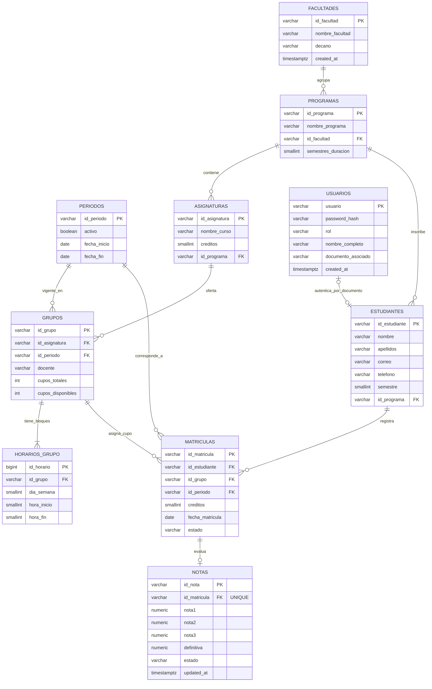

---

## 2. DIAGRAMAS UML DE ESTRUCTURA (7 DIAGRAMAS)

### 2. Diagrama de Clases
Representación estática de las clases de dominio y servicios principales del backend con modificadores de visibilidad (`+`, `-`, `#`), tipos de datos, métodos y multiplicidades.

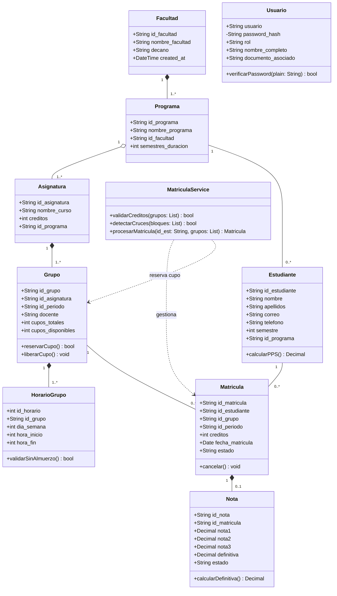

---

### 3. Diagrama de Objetos
Instancia estática en tiempo de ejecución mostrando el estado real en memoria de una matrícula activa del estudiante `1001` (Alejandro Campo Solarte).

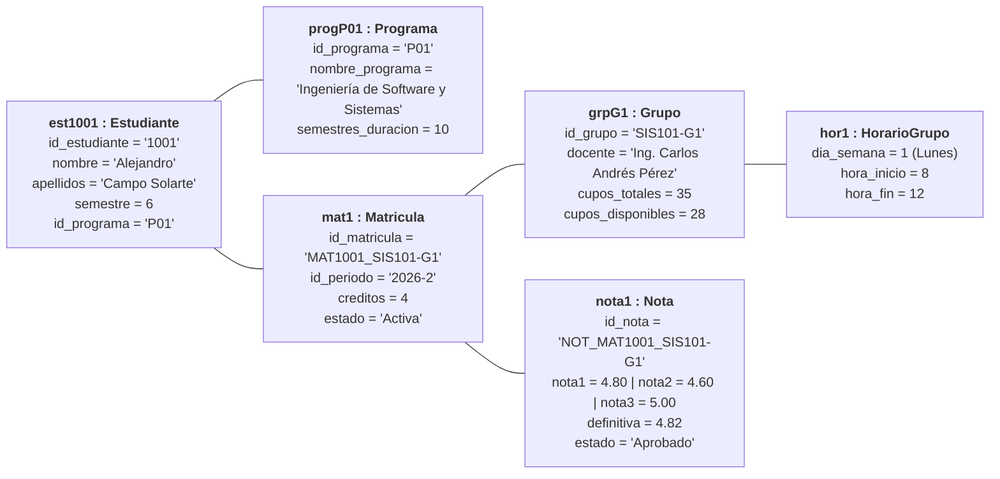

---

### 4. Diagrama de Componentes
Organización modular del software, dependencias e interfaces provistas (`I*`) y requeridas entre Frontend, API FastAPI, Servicios y Base de Datos.

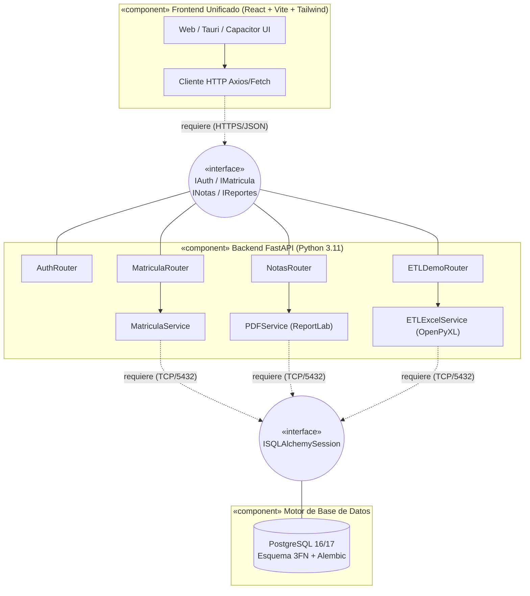

---

### 5. Diagrama de Despliegue (Local)
Topología física y entorno de ejecución en el equipo local (`AS-IS`) mediante Docker Compose, Vite y clientes nativos.

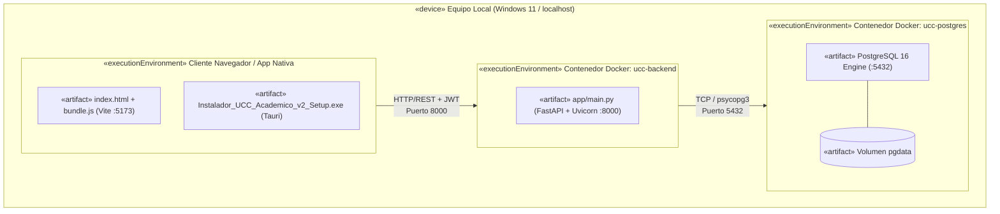

---

### 6. Diagrama de Paquetes
Organización en capas lógicas del proyecto y sus relaciones de dependencia (`«import»` / `«access»`).

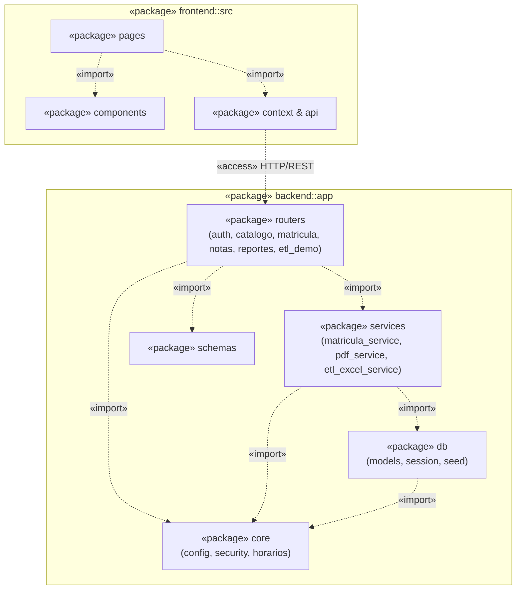

---

### 7. Diagrama de Estructura Compuesta
Estructura interna del componente principal **`BackendAPI`** mostrando sus partes internas, conectores y puertos explícitos de entrada/salida.

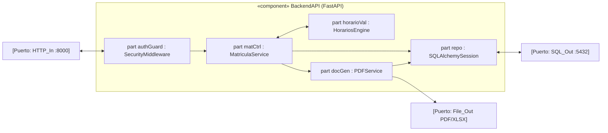

---

### 8. Diagrama de Perfiles
Extensión del metamodelo UML adaptada al dominio web de FastAPI + SQLAlchemy + React mediante estereotipos personalizados.

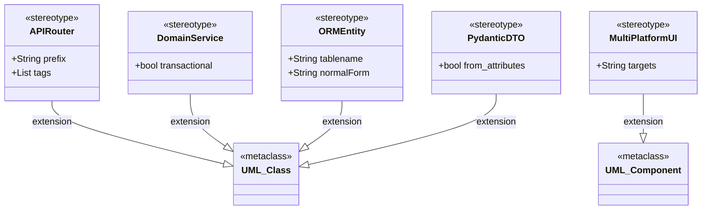

---

## 3. DIAGRAMAS UML DE COMPORTAMIENTO (7 DIAGRAMAS)

### 9. Diagrama de Casos de Uso
Límites del sistema, actores externos (`Estudiante`, `Docente`, `Administrador`) y relaciones (`«include»`, `«extend»`).

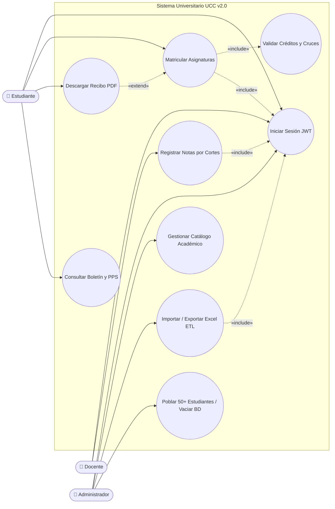

---

### 10. Diagrama de Actividades
Flujo de trabajo operativo del proceso de **Matrícula Inteligente** dividido en carriles (swimlanes) por actor/componente.

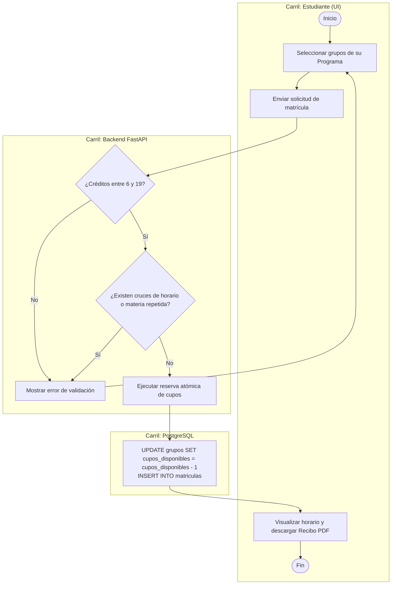

---

### 11. Diagrama de Máquina de Estados
Ciclo de vida y transiciones de estado de la entidad principal **`Matricula`** y su relación con la evaluación (`Nota`).

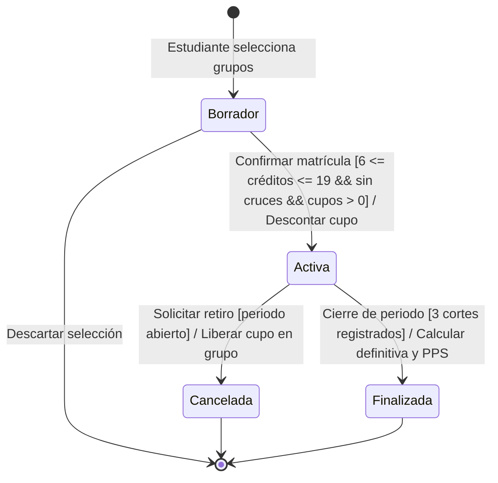

---

### 12. Diagrama de Secuencia
Intercambio ordenado temporalmente de mensajes en el flujo de **Registro de Matrícula** entre Navegador, Frontend, API FastAPI y PostgreSQL.

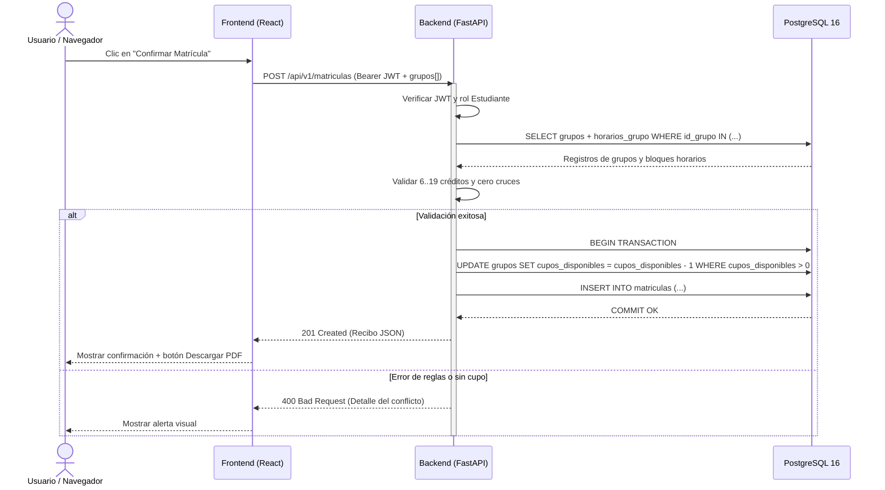

---

### 13. Diagrama de Comunicación
Organización estructural de los objetos que colaboran en el **Registro de Calificaciones** con mensajería numerada secuencialmente.

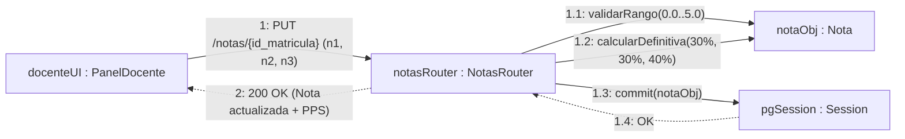

---

### 14. Diagrama de Temporización
Cambios de estado y restricciones de tiempo de respuesta en una transacción de matrícula típica (`t` en milisegundos).

```mermaid
gantt
    title Diagrama de Temporización — Transacción de Matrícula (Escala en ms)
    dateFormat X
    axisFormat %L ms

    section Frontend UI
    Inactivo / Selección          :a1, 0, 50
    Esperando API (Loading)       :active, a2, 50, 260
    Render Confirmación           :done, a3, 260, 300

    section FastAPI Backend
    Validación JWT + Reglas       :b1, 60, 120
    Transacción Atómica           :crit, b2, 120, 230
    Serialización JSON            :b3, 230, 255

    section PostgreSQL
    Lock + UPDATE Cupos + INSERT  :c1, 130, 220
```

---

### 15. Diagrama de Vista General de Interacciones
Encadenamiento global de marcos de interacción (`sd`) con rutas alternativas y decisiones del sistema académico completo.

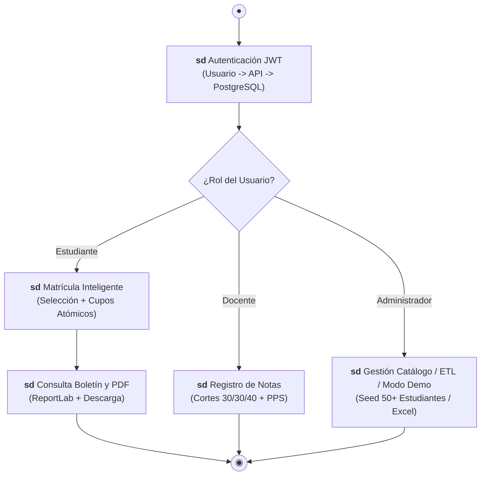
