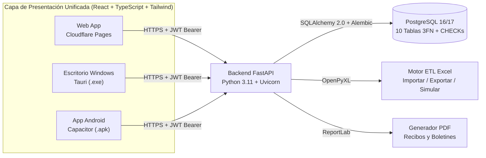

<div align="center">

# 🏛️ UNIVERSIDAD COOPERATIVA DE COLOMBIA
### **Campus Cali · Facultad de Ingeniería — Ingeniería de Sistemas**
### **Asignatura:** Ingeniería de Software
### **Dirigido a:** Docente Evaluador — Facultad de Ingeniería

---

# 📘 DOCUMENTO ENTREGABLE DEL PROYECTO
## **Sistema Integral de Gestión Académica, Matrículas y Calificaciones (v2.0)**

[]()
[]()
[]()
[]()
[]()
[]()

</div>

---

## 📋 1. Ficha Técnica del Entregable

| Campo | Detalle |
| :--- | :--- |
| **Institución** | Universidad Cooperativa de Colombia (UCC) — Sede Cali |
| **Facultad / Programa** | Facultad de Ingeniería — Ingeniería de Sistemas |
| **Asignatura** | Ingeniería de Software |
| **Docente Evaluador** | Docente Titular — Ingeniería de Software (UCC Cali) |
| **Equipo de Desarrollo** | 1. **Alejandro Campo Solarte** (ID Timonel: `938203`)<br>2. **Juan Esteban Cardona Calambas** (ID Timonel: `939422`)<br>3. **Diego Fernando Gómez Rivera** (ID Timonel: `937804`) |
| **Repositorio GitHub** | [github.com/SlayerCampo/SistemaUniversitarioDeGestion](https://github.com/SlayerCampo/SistemaUniversitarioDeGestion) |
| **📐 Diagramas UML 2.5 y MER (15 Modelos)** | 👉 **[Ver los 15 Diagramas UML y MER completos aquí](./DIAGRAMAS_UML_Y_MER.md)** |
| **Periodo Académico Base** | `2026-2` |

---

## 🎯 2. Descripción y Propósito de la Tarea

El **Sistema Integral de Gestión Académica, Matrículas y Calificaciones (v2.0)** es una plataforma multiplataforma (Web, Escritorio Windows y Móvil Android) diseñada bajo principios de **Ingeniería de Software moderna** para centralizar, automatizar y blindar los procesos académicos clave de una institución universitaria:

1. **Gestión del Catálogo Académico:** Administración de 5 Facultades, 8 Programas Académicos, 120 Asignaturas y 240 Grupos en jornadas diurna y nocturna.
2. **Proceso de Matrícula Inteligente (4 Pasos):** Selección de grupos filtrados estrictamente al programa del estudiante, validación automática de rango de créditos (**6 a 19 créditos**), prevención de materias duplicadas, detección matemática de cruces de horario y **reserva atómica de cupos** en PostgreSQL.
3. **Gestión Docente y Calificaciones por Cortes:** Registro de notas por corte académico — **Corte 1 (30%)**, **Corte 2 (30%)** y **Corte 3 (40%)** — con cálculo automático de nota definitiva, estado (`Aprobado` / `Reprobado`) y **Promedio Ponderado Semestral (PPS)**.
4. **Reportes Oficiales en PDF:** Generación dinámica con `ReportLab` de **Recibo Oficial de Matrícula** y **Boletín Académico de Calificaciones**, con descarga nativa en Web, Windows y Android.
5. **Motor ETL Excel y Generador de Simulación Institucional:** Generación automática de **50+ estudiantes aleatorios con datos completos** (nombres, apellidos, correos institucionales, teléfonos, programas, matrículas sin cruces y notas realistas), importación/exportación masiva `.xlsx` y centro de demostración (`⚡ Modo Demo`) para sustentación en vivo.

---

## 🏗️ 3. Arquitectura del Software (1 Backend + 1 Frontend = 3 Plataformas)

El sistema implementa una arquitectura cliente-servidor desacoplada donde **una única base de código Frontend** (`React + TypeScript + Tailwind CSS`) se compila simultáneamente para:
- **Aplicación Web Responsive** (Cloudflare Pages)
- **Aplicación de Escritorio Windows** con instalador nativo `.exe` (Tauri + NSIS)
- **Aplicación Móvil Android** instalable `.apk` (Capacitor)

Todas consumen la misma **API REST en FastAPI (Python 3.11)** respaldada por **PostgreSQL 16/17 normalizado en Tercera Forma Normal (3FN)**.



---

## 🛡️ 4. Reglas de Negocio Blindadas (Backend + PostgreSQL)

| # | Regla de Negocio | Mecanismo de Blindaje |
| :-: | :--- | :--- |
| 1 | **Franja Protegida de Almuerzo (13:00–14:00)** | Validador Python (`horarios.py`) + `CHECK CONSTRAINT` físico en PostgreSQL: `NOT (hora_inicio < 14 AND hora_fin > 13)`. |
| 2 | **Jornada y Bloques Válidos** | Clases de lunes a sábado (`1..6`), entre `06:00` y `22:00`, bloques continuos de `2`, `3` o `4` horas. |
| 3 | **Rango de Créditos por Matrícula** | Mínimo **6 créditos**, máximo **19 créditos** por periodo académico. |
| 4 | **Cero Cruces de Horario y Cero Repetición** | Detector matemático de intersección de bloques horarios y validación de asignatura base única. |
| 5 | **Concurrencia y Cupos Atómicos** | Actualización atómica en SQL (`WHERE cupos_disponibles > 0`) + índice único parcial para evitar doble matrícula activa. |
| 6 | **Calificaciones y Seguridad** | Notas restringidas a `[0.00, 5.00]` con `CHECK` en BD; contraseñas cifradas con **bcrypt** y control de acceso por roles (**RBAC + JWT**). |
| 7 | **Privacidad de Datos (Ley 1581 de 2012)** | Datos 100% sintéticos (`1001`–`1050`); ningún dato personal real almacenado. |

---

## ⚡ 5. Funcionalidad de Generación Aleatoria y Modo Demo

El sistema incluye un motor completo de simulación institucional listo para pruebas y sustentación:
- **Generador de 50+ Estudiantes Aleatorios (`POST /api/v1/demo/poblar`):** Crea automáticamente 5 Facultades, 8 Programas, 120 Asignaturas, 240 Grupos (mañana y tarde/noche sin cruces con almuerzo), 50 estudiantes con información completa, matrículas válidas (12–16 créditos sin cruces) y notas realistas por cortes.
- **Generador de Excel de Simulación (`GET /api/v1/etl/generar-simulacion`):** Descarga un archivo `.xlsx` completo con toda la universidad simulada listo para pruebas ETL.
- **Cambio de Rol en 1 Clic:** Permite alternar instantáneamente entre `Administrador`, `Docente` y `Estudiante (1001)` durante la exposición.

---

## 📦 6. Instaladores y Entregables Compilados

| Plataforma | Archivo Generado | Descripción |
| :--- | :--- | :--- |
| **Windows (Escritorio)** | `dist_installer/Instalador_UCC_Academico_v2_Setup.exe` | Instalador clásico con asistente (*Siguiente → Instalar → Acceso directo en Escritorio y Menú Inicio*). |
| **Android (Móvil)** | `dist_installer/UCC_Academico_v2.apk` | Aplicación nativa instalable en cualquier dispositivo Android. |
| **Web (Navegador)** | `frontend/dist/` | Compilación optimizada lista para Cloudflare Pages. |
| **Diagramas UML y MER** | `DIAGRAMAS_UML_Y_MER.md` | Los 15 diagramas requeridos (1 MER + 7 UML Estructura + 7 UML Comportamiento). |

---

## 🚀 7. Guía Rápida de Ejecución y Pruebas

### Ejecución Local (Docker + `pnpm`)
```bash
# 1. Levantar PostgreSQL 16 + Backend FastAPI
docker compose up -d --build

# 2. Ejecutar suite de pruebas automatizadas (pytest)
docker compose exec backend pytest -v

# 3. Iniciar Frontend Web
pnpm install
pnpm dev
```
- **Web Local:** `http://localhost:5173`
- **API Swagger Docs:** `http://localhost:8000/docs`
- **Health Check:** `http://localhost:8000/health`

### Credenciales de Demostración
| Rol | Usuario | Contraseña |
| :--- | :---: | :---: |
| **Administrador** | `admin` | `1234` |
| **Docente** | `profe` | `1234` |
| **Estudiante** | `1001` (hasta `1050`) | `1234` |

---

<div align="center">
  <b>Universidad Cooperativa de Colombia — Campus Cali · Ingeniería de Software · 2026</b>
</div>
