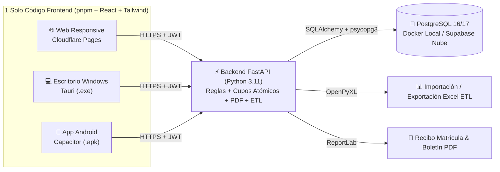

<div align="center">

# 🏛️ UNIVERSIDAD COOPERATIVA DE COLOMBIA
### **Campus Cali · Facultad de Ingeniería — Ingeniería de Software**
### _Sistema Integral de Gestión Académica, Matrículas y Calificaciones (v2.0)_

**Proyecto académico · Ingeniería de Software · UCC Campus Cali**

[](https://fastapi.tiangolo.com/)
[](https://www.postgresql.org/)
[](https://react.dev/)
[](https://tauri.app/)
[](https://capacitorjs.com/)
[](https://www.docker.com/)

---

### 🚀 **Descargas Oficiales y Accesos Directos**

| 💻 **App de Escritorio Windows (`.exe`)** | 📱 **App Móvil Android (`.apk`)** | 📦 **Respaldo Histórico v1.0** |
| :---: | :---: | :---: |
| [](https://github.com/SlayerCampo/SistemaUniversitarioDeGestion/releases) | [](https://github.com/SlayerCampo/SistemaUniversitarioDeGestion/releases) | [](https://github.com/SlayerCampo/SistemaUniversitarioDeGestion/tree/v1.0-legacy) |

</div>

---

> [!NOTE]
> ### 🛡️ Nota de Transparencia y Seguridad para el Docente Evaluador
> * **Código 100% abierto y auditable:** Todo el código fuente del backend (`FastAPI` + `PostgreSQL`), el frontend unificado (`React + TypeScript + Tailwind`) y las envolturas de escritorio (`Tauri`) y Android (`Capacitor`) se encuentra público en este repositorio.
> * **Datos 100% sintéticos (Ley 1581 de 2012):** Ninguna cédula o registro de prueba corresponde a datos personales reales; se utilizan identificadores sintéticos (`1001`–`1050`) y contraseñas cifradas con **bcrypt** + sesiones **JWT**.
> * **Sobre Windows SmartScreen / Android orígenes desconocidos:** Al tratarse de un proyecto universitario sin certificado comercial de firma digital de pago anual, Windows o Android pueden mostrar un aviso preventivo al abrir el `.exe` o el `.apk`. Basta con pulsar **"Más información → Ejecutar de todas formas"** (Windows) o **"Instalar de todas formas"** (Android).

El Sistema Universitario de Gestión es una solución académica desarrollada en Python para centralizar procesos de matrícula, consulta de asignaturas, control de cupos, validación de horarios y gestión de calificaciones.

## 👥 Equipo de Desarrollo

* **Institución:** Universidad Cooperativa de Colombia (UCC) — Sede Cali
* **Programa:** Ingeniería de Sistemas
* **Asignatura:** Ingeniería de Software
* **Integrantes:**
  1. 👤 **Alejandro Campo Solarte** — ID Timonel: `938203`
  2. 👤 **Juan Esteban Cardona Calambas** — ID Timonel: `939422`
  3. 👤 **Diego Fernando Gómez Rivera** — ID Timonel: `937804`

Ambas versiones comparten el catálogo académico, las reglas de negocio y la generación de reportes PDF. La persistencia local utiliza archivos Excel, lo que facilita la demostración, el respaldo y la carga masiva de información sin configurar un servidor de base de datos.

## 🏗️ Arquitectura Unificada v2.0 (1 Backend + 1 UI = 3 Plataformas Idénticas)

En la versión 2.0 se eliminó por completo la duplicación entre escritorio y web y se migró la base de datos principal de Excel hacia **PostgreSQL normalizado (3FN)**:



### ✨ Reglas de Negocio Blindadas en Servidor y PostgreSQL
1. **Esquema Relacional Normalizado (10 Tablas en 3FN):** `facultades`, `programas`, `periodos`, `asignaturas`, `grupos`, `horarios_grupo`, `estudiantes`, `matriculas`, `notas`, `usuarios` con migraciones **Alembic** e índices en todas las llaves foráneas.
2. **Restricción Física de Almuerzo (13:00–14:00):** Blindada tanto en el validador Python como mediante un `CHECK CONSTRAINT` real en PostgreSQL (`NOT (hora_inicio < 14 AND hora_fin > 13)`). Bloques de `2`, `3` o `4` horas continuas entre `06:00` y `22:00`.
3. **Matrícula Inteligente en 4 Pasos + Horario Semanal Visual:**
   - Oferta filtrada exclusivamente al Programa Académico del estudiante (5 Facultades, 8 Programas, 120 Asignaturas, 240 Grupos).
   - Validación de **6 a 19 créditos**, no repetición de asignatura base, detector matemático de cruces y **reserva atómica de cupos** (`UPDATE grupos SET cupos_disponibles = cupos_disponibles - 1 WHERE id_grupo = :id AND cupos_disponibles > 0`).
4. **Calificación por Cortes y PPS:** Corte 1 (`30%`), Corte 2 (`30%`) y Corte 3 (`40%`), cálculo automático de definitiva y Promedio Ponderado Semestral (PPS), más descarga nativa de **Boletín PDF** y **Recibo de Matrícula PDF** (incluso en Android mediante Capacitor Filesystem + Share).
5. **Centro de Exposición (`⚡ Modo Demo`):** Cajón lateral limpio y controlado por `DEMO_MODE=true` para cambiar de rol en 1 clic (`Administrador`, `Docente`, `Estudiante 1001`), poblar 50+ estudiantes, vaciar la BD con confirmación explícita (`VACIAR`) y alternar la URL del servidor API (Nube vs. Docker local).
6. **Descarga Inteligente en la Web:** Detecta automáticamente si el visitante accede desde **Windows PC** (prioriza el `.exe` + código QR para el celular) o desde **Android** (prioriza el `.apk` y protege contra descargas accidentales del `.exe`).

El instalador para Windows está disponible en [Releases](https://github.com/SlayerCampo/SistemaUniversitarioDeGestion/releases). Como el ejecutable no utiliza un certificado comercial de firma de código, Windows SmartScreen puede mostrar una advertencia preventiva. También es posible ejecutar el proyecto desde el código fuente siguiendo las instrucciones de instalación local.

## 💻 Ejecución Local con Docker y `pnpm` (Plan B para Sustentación)

### 1. Clonar el Repositorio
```bash
git clone https://github.com/SlayerCampo/SistemaUniversitarioDeGestion.git
cd SistemaUniversitarioDeGestion
python -m venv .venv
```

### 2. Levantar PostgreSQL 16 + Backend FastAPI en Docker
```bash
docker compose up -d --build
```
* API disponible en: `http://localhost:8000`
* Documentación interactiva Swagger/OpenAPI: `http://localhost:8000/docs`
* Salud del sistema y BD: `http://localhost:8000/health`

### 3. Ejecutar Pruebas Automatizadas de Reglas de Negocio (`pytest`)
```bash
docker compose exec backend pytest -v
```

### 4. Ejecutar el Frontend Unificado con `pnpm`
```bash
pnpm install
pnpm dev
```
* Abre `http://localhost:5173` en tu navegador (o desde el celular usando tu IP local en la misma red Wi-Fi).

---

## ☁️ Despliegue 100% Gratuito en Internet (Paso a Paso)

1. **Base de Datos PostgreSQL 17 (Supabase — Gratis):**
   * Crea un proyecto gratuito en [supabase.com](https://supabase.com) y copia la cadena **Connection Pooler (Session mode / URI)** (`postgresql://...`).
2. **Backend FastAPI (Render — Gratis):**
   * En [dashboard.render.com](https://dashboard.render.com) → **New → Blueprint** (o **Web Service** seleccionando Docker y `./backend/Dockerfile`).
   * Configura las variables de entorno:
     * `DATABASE_URL` = tu URI de PostgreSQL en Supabase.
     * `JWT_SECRET_KEY` = cadena secreta aleatoria larga.
     * `DEMO_MODE` = `true` (para tu sustentación).
     * `CORS_ORIGINS` = tu URL de Cloudflare Pages + `http://tauri.localhost,https://tauri.localhost,capacitor://localhost,http://localhost`.
   * *Tip de exposición:* Abre `https://tu-api.onrender.com/health` 2 minutos antes de exponer para despertar el contenedor gratuito.
3. **Frontend Web (Cloudflare Pages — Gratis):**
   * En [dash.cloudflare.com](https://dash.cloudflare.com) → **Workers & Pages → Create → Pages → Connect to Git**.
   * Selecciona `SlayerCampo/SistemaUniversitarioDeGestion`:
     * **Root directory:** `frontend`
     * **Build command:** `pnpm install && pnpm build`
     * **Build output directory:** `dist`
     * **Variable de entorno:** `VITE_API_URL=https://tu-api.onrender.com/api/v1`
4. **Instaladores `.exe` y `.apk` (GitHub Releases — Gratis):**
   * Publica una Release `v2.0.0` en GitHub adjuntando:
     * `Instalador_UCC_Academico_v2_Setup.exe`
     * `UCC_Academico_v2.apk`
   * La sección **Apps PC / Android** de tu web apunta automáticamente a la última Release publicada.

Para crear un acceso directo de la versión de escritorio, ejecuta `Crear_Acceso_Directo.bat` dentro de `1_Version_Escritorio_Avanzada`.

## Flujo de demostración recomendado

1. Abre la [versión web](https://sistemauniversitariodegestion.streamlit.app/) o ejecuta la aplicación localmente.
2. Revisa los indicadores de la página principal.
3. En **Administración**, carga datos o genera el archivo de demostración.
4. En **Matrícula**, selecciona un estudiante y prueba la validación de créditos, cupos y horarios.
5. Consulta el **Boletín** y descarga el PDF.
6. En el **Panel Docente**, registra notas y observa el cálculo del promedio.

La clave `1234` corresponde al modo de demostración incluido en la aplicación. No debe utilizarse como mecanismo de autenticación para un entorno real.

## Estructura del repositorio

```text
SistemaUniversitarioDeGestion/
├── 1_Version_Escritorio_Avanzada/
│   ├── core/                 # Reglas de negocio y validaciones
│   ├── data/                 # Persistencia, catálogo y carga de datos
│   ├── reports/              # Reportes PDF
│   ├── ui/                   # Vistas de la aplicación de escritorio
│   ├── main.py               # Punto de entrada
│   └── schema_universidad.sql
├── 2_Version_Web_Desplegable/
│   ├── database/             # Persistencia y estilos web
│   ├── pages/                # Matrícula, notas, docentes y administración
│   └── app.py                # Punto de entrada web
├── Ejecutar_Escritorio.bat
├── Ejecutar_Web.bat
├── requirements.txt
├── LICENSE
└── README.md
```

## Equipo

- **Alejandro Campo Solarte** — ID Timonel: 938203
- **Juan Esteban Cardona Calambas** — ID Timonel: 939422
- **Diego Fernando Gómez Rivera** — ID Timonel: 937804

**Institución:** Universidad Cooperativa de Colombia · Sede Cali
**Programa:** Ingeniería de Sistemas
**Asignatura:** Ingeniería de Software

## Alcance y consideraciones

- La persistencia basada en Excel está pensada para demostración y uso local; no sustituye una base de datos institucional multiusuario.
- Los datos incluidos o generados son de demostración.
- La clave de demostración y los datos simulados no deben reutilizarse en producción.
- Antes de distribuir el instalador, verifica su procedencia y el contenido de la versión publicada.

## Licencia

Este proyecto se distribuye bajo la [Licencia MIT](LICENSE).

<div align="center">
  <b>Universidad Cooperativa de Colombia — Campus Cali · 2026</b>
</div>
