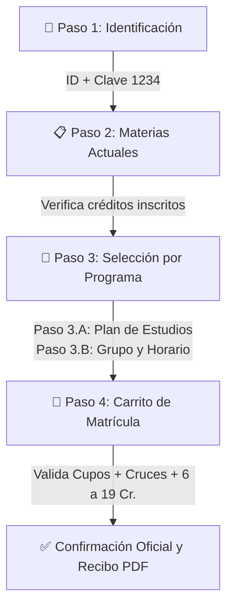

<div align="center">

# UNIVERSIDAD COOPERATIVA DE COLOMBIA

### **Campus Cali · Facultad de Ingeniería**

### _Sistema Inteligente de Gestión Académica, Matrículas y Calificaciones_

---

[](https://www.python.org/)
[](https://streamlit.io/)
[](https://github.com/TomSchimansky/CustomTkinter)
[](https://openpyxl.readthedocs.io/)
[](https://www.reportlab.com/)
[](LICENSE)

---

### **Accesos Directos del Proyecto**

|                                                                                 🌐 **Versión Web en la Nube (Streamlit Cloud)**                                                                                 |                                                                                    💻 **Versión de Escritorio (Instalador PC)**                                                                                     |
| :-------------------------------------------------------------------------------------------------------------------------------------------------------------------------------------------------------------: | :-----------------------------------------------------------------------------------------------------------------------------------------------------------------------------------------------------------------: |
| [](https://share.streamlit.io/)<br/>_(Disponible 24/7 para celulares, tablets y PC)_ | [](https://github.com/)<br/>_(Ejecutable autónomo con acceso directo e icono oficial)_ |

---

</div>

## 👥 Equipo de Desarrollo e Información Académica

- **Institución:** Universidad Cooperativa de Colombia (UCC) — Sede Cali
- **Programa Académico:** Ingeniería de Sistemas
- **Asignatura:** Ingeniera de software
- **Integrantes del Grupo:**
  1. 👤 **Alejandro Campo Solarte** — ID: 938203
  2. 👤 **Juan Esteban Cardona Calambas** — ID: 939422
  3. 👤 **Diego Fernando Gómez Rivera** — ID:

---

## 📌 Descripción General

El **Sistema Universitario UCC** es una solución integral de software concebida con **arquitectura dual** para atender las necesidades de matriculación, oferta académica, seguimiento de calificaciones y administración institucional. Integra dos clientes sincronizados:

1. **Cliente de Escritorio Avanzado (`1_Version_Escritorio_Avanzada/`):** Aplicación de alto rendimiento basada en `CustomTkinter` con interfaz gráfica moderna, ventanas modulares protegidas contra cierres involuntarios, formularios con etiquetas superiores y ejemplos internos, textos deslizables sin barras toscas y creador de acceso directo con el icono oficial de la UCC.
2. **Cliente Web Responsivo (`2_Version_Web_Desplegable/`):** Aplicación web interactiva construida sobre `Streamlit`, 100% en español (sin botones `Deploy` en inglés ni menús innecesarios), completamente adaptable a teléfonos celulares (`@media (max-width: 640px)`) y computadores, dotada de un **Simulador de Sesión Estudiantil con clave cómoda (`1234`)**.

---

## ✨ Características y Reglas del Negocio Académico



### 1. Matrícula Académica Inteligente en 4 Pasos

- **Paso 1 (Estudiante y Periodo):**
  - **Modo Libre / Demo:** Permite al evaluador consultar cualquier estudiante.
  - **Simulador de Sesión (ID + Contraseña `1234`):** Bloquea la sesión para un único estudiante, ocultando la lista de los demás para garantizar estricta privacidad.
- **Paso 2 (Asignaturas Activas):** Muestra en tarjetas visuales las materias ya inscritas en el periodo con sus créditos correspondientes.
- **Paso 3 (Selección Filtrada en 2 Tiempos):**
  - **Paso 3.A:** El estudiante solo puede ver las asignaturas de su propio Programa Académico.
  - **Paso 3.B:** Selección de Grupo y Horario disponible.
- **Paso 4 (Carrito y Validación en Tiempo Real):**
  - Control estricto de créditos: Mínimo **6 créditos** y máximo **19 créditos** por semestre.
  - Detector algorítmico de cruces de horarios y control de cupos en vivo.
  - Emisión y descarga inmediata de **Recibo Oficial de Matrícula en PDF**.

### 2. Oferta Académica Realista y Restricción de Almuerzo

- **5 Facultades Oficiales:** Ingeniería, Ciencias Económicas, Psicología y Ciencias Sociales, Derecho y Ciencias Políticas, y Ciencias de la Salud.
- **8 Programas Académicos:** Ingeniería de Software, Ingeniería Industrial, Administración de Empresas, Contaduría Pública, Psicología, Derecho, Enfermería y Medicina.
- **120 Asignaturas y 240 Grupos Ofertados:** 15 asignaturas por programa x 2 grupos paralelos por asignatura.
- **Bloque de Horas Pedagógicas:** Asignaturas de 2, 3 o 4 horas continuas según su carga en créditos.
- 🚫 **Regla Estricta de Almuerzo:** **Ninguna clase tiene horario entre las 13:00 y las 14:00 horas**, respetando el bienestar universitario.

### 3. Centro de Datos ETL y Modo Inicial en Blanco

- La base de datos inicia **completamente en blanco** en su primera visita para permitir registros limpios desde cero.
- Botón para generar un archivo Excel (`.xlsx`) con **50 estudiantes simulados y distribuidos equitativamente**, listos para importar manualmente mediante un buscador de archivos de Windows.
- Funciones de vaciado, respaldo y exportación de datos en caliente.

### 4. Panel Docente y Boletín de Calificaciones

- Calificación por tres cortes oficiales: **Corte 1 (30%)**, **Corte 2 (30%)** y **Corte 3 (40%)**.
- Planilla completa en lote para computador y modo individual adaptativo para celular.
- Cálculo automático del **Promedio Ponderado Semestral (PPS)** y descarga de Boletín Oficial en PDF.

---

## 📂 Estructura del Repositorio

```text
Sistema_Universitario_UCC/
├── .gitignore                          # Exclusión de archivos basura, temporales y caché
├── requirements.txt                    # Dependencias unificadas para instalación rápida
├── README.md                           # Documentación técnica oficial
├── Ejecutar_Escritorio.bat             # Lanzador rápido de la app de escritorio (1 clic)
├── Ejecutar_Web.bat                    # Lanzador rápido del portal web en local (1 clic)
│
├── 1_Version_Escritorio_Avanzada/       # CLIENTE DE ESCRITORIO (CustomTkinter)
│   ├── main.py                         # Ventana principal del sistema
│   ├── config.py                       # Configuración y temas visuales UCC
│   ├── logo_ucc.png                    # Logotipo institucional UCC en PNG
│   ├── logo_ucc.ico                    # Icono de alta resolución para Windows
│   ├── Crear_Acceso_Directo.bat        # Generador de acceso directo en el Escritorio
│   ├── poblar_datos.py                 # Generador de 50 estudiantes en Excel
│   ├── schema_universidad.sql          # Esquema relacional SQL
│   ├── core/                           # Gestor de base de datos Excel y validaciones
│   ├── data/                           # Catálogo académico de programas y asignaturas
│   ├── ui/                             # Ventanas modulares del sistema
│   └── reports/                        # Motor de generación de reportes PDF (ReportLab)
│
└── 2_Version_Web_Desplegable/          # CLIENTE WEB RESPONSIVO (Streamlit)
    ├── app.py                          # Portal principal y explorador de oferta
    ├── logo_ucc.png                    # Logotipo institucional UCC
    ├── logo_ucc.ico                    # Icono web
    ├── requirements.txt                # Dependencias específicas de la nube
    ├── .streamlit/
    │   └── config.toml                 # Tema institucional UCC y modo visor
    ├── database/
    │   ├── repo.py                     # Motor relacional y persistencia Excel
    │   └── estilos_web.py              # CSS responsivo y componentes en español
    └── pages/
        ├── 1_🎓_Matricula.py           # Portal de matrícula guiado en 4 pasos
        ├── 2_📊_Notas_y_Boletin.py     # Consulta de notas, PPS y boletín PDF
        ├── 3_👨‍🏫_Panel_Docente.py      # Planilla de notas para docentes
        └── 4_⚙️_Administracion.py       # Centro ETL y explorador de tablas
```

---

## 💻 Instalación y Ejecución Local

### 1. Clonar el Repositorio

```bash
git clone https://github.com/TU_USUARIO/Sistema_Universitario_UCC.git
cd Sistema_Universitario_UCC
```

### 2. Instalar las Dependencias

Se recomienda utilizar Python 3.9 o superior:

```bash
pip install -r requirements.txt
```

### 3. Ejecutar las Aplicaciones

- **Opción A (Mediante lanzadores en 1 clic):**
  - Doble clic en `Ejecutar_Escritorio.bat` para abrir la versión de escritorio.
  - Doble clic en `Ejecutar_Web.bat` para abrir la versión web en el navegador.

- **Opción B (Mediante la consola PowerShell o Terminal):**
  - **Versión Escritorio:**
    ```powershell
    python "1_Version_Escritorio_Avanzada/main.py"
    ```
  - **Versión Web:**
    ```powershell
    python -m streamlit run "2_Version_Web_Desplegable/app.py"
    ```

- **Crear el Acceso Directo de Escritorio:**
  - Entra a la carpeta `1_Version_Escritorio_Avanzada` y haz doble clic sobre `Crear_Acceso_Directo.bat`. Se creará un acceso directo en tu Escritorio de Windows con el logotipo oficial de la UCC.

---

<div align="center">
  <b>Universidad Cooperativa de Colombia — Campus Cali · 2026</b><br/>
  <i>Desarrollado con pasión para la excelencia en Ingeniería de Software.</i>
</div>
